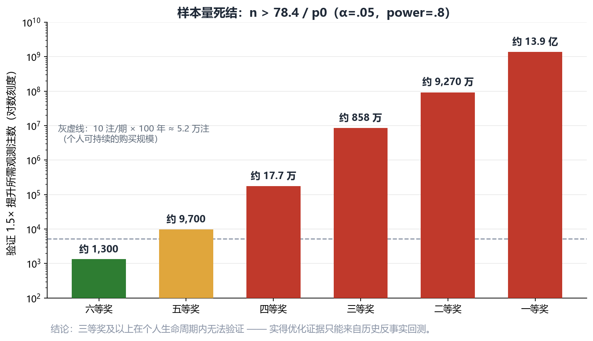
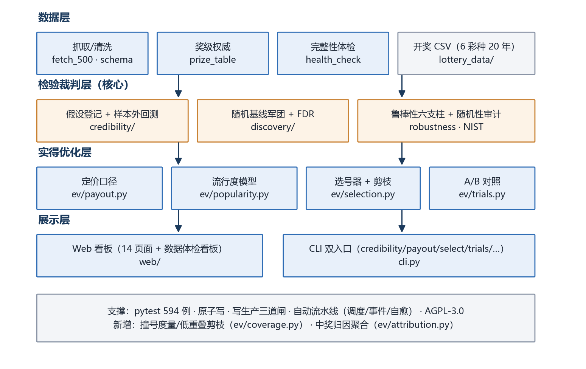
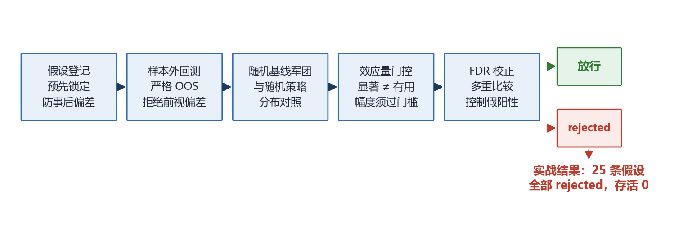
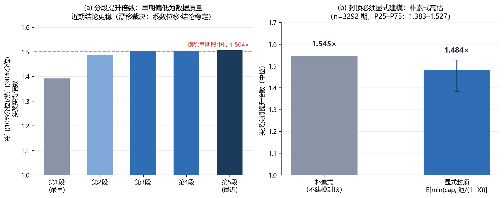

# 时间序列分析框架 —— 结题报告

> **带严格统计检验的时间序列分析框架（彩票作为示例场景）**
>
> 版本：v1.3 ｜ 日期：2026-10-21 ｜ 许可：AGPL-3.0（仓库当前为私有，未公开发布）｜ 仓库：<https://github.com/Zalgo1024/lottery-prediction-analyzer>
> 运行环境：Python 3.10 ｜ 测试：pytest 1880 例通过 ｜ 数据：6 彩种约 20 年开奖历史

---

## 0. 这是什么？（非技术读者先读这一页）

> **一句话说清：** 这是一个彩票数据分析与预测方法检验项目。项目以彩票开奖数据为试验场，搭建了一套严格的统计检验流程，逐一检验各种"提高中奖率"的方法，并围绕奖金侧给出了一个可落地的优化结论——在平分奖金的规则下，买冷门号码虽然不能让中奖率变高，却能让中奖后分到的钱平均多约 48%。

**为什么会做这个。** 起点很朴素：想做一个能算彩票号码的程序，希望用更少的注数中更大的奖。做着做着发现必须先解决一个更基础的问题——怎么客观判断"一个方法到底有没有效"。否则任何一次"看着挺灵"都可能只是巧合。

**为什么拿彩票当试验场。** 彩票数据规则完全公开、结果纯随机、没有任何内部信息可以利用，是检验一套时序分析方法是否真有预测力的理想试验场。如果一套检验流程能在这种场景里清楚地判别"有信号"与"没信号"，并且能说清每一次"好像有信号"是怎么冒出来的（样本内碰巧、假设挑多了、数学近似失效、规则中途改过……），那么把它用到别的真实数据上，才更值得信。

**最后交出了三样东西：**

| 交付物 | 一句话说明 |
|---|---|
| 一套假设检验流程 | 任何"我能预测得更准"的说法，都要依次过五道检验：先登记要测什么 → 用没见过的数据回测 → 跟大量随机策略比 → 看效果幅度够不够大 → 校正"试得多了总会撞上"的假阳性。缺一不可。 |
| 一份检验记录 | 6 个彩种、25 个具体假设逐一检验，过程与结果全部公开、可复现。 |
| 一个可落地的副产品 | 彩票一/二等奖是"中的人平分奖金"。人群偏爱生日号、连号，所以冷门号码中奖时被分走的更少。用 3292 期历史回放测算：冷门组合中奖后的实得约为热门的 **1.484 倍**。注意——这提高的是"中了以后拿多少"，不是"更容易中"。 |

**还有三条边界，写在最前面**（这类项目最容易吹过头）：

1. 中奖概率能否提高，在三等奖以上是**没法验证**的——想证明"中奖率提高 50%"，一等奖需要约 13.9 亿注样本，一个人一辈子也攒不出来。
2. 因此实得结论来自**历史回放测算**而非未来实验，它成立的前提是"大家的选号习惯大致延续"。
3. 单注长期期望仍是亏的（约 −50%），本项目**不承诺赚钱**，只承诺"同样的花销、同样的中奖概率下，中奖时拿得更多一点"。

**怎么读这份报告：** 只想搞懂"这是什么东西" → 本章 + §1 摘要 + 各章开头的「本章在说什么」；想看方法论 → §2~§5；想看工程实现 → §6；想知道哪些话不能说 → §7；术语看不懂 → §8.5 有一张"人话对照表"。

---

## 1. 摘要

> **本章在说什么：** 一页看完：项目做了什么、发现了什么、交付了什么，以及整份报告怎么组织。

本项目构建了一套**以严格统计检验为核心**的时间序列分析框架，并选择彩票开奖数据作为检验场景——因为它是"最严苛的测试场"：无协变量、无趋势、大样本、完全随机。任何看似有效的预测策略都要在这里接受检验。

项目的核心产出不是"预测模型"，而是三个可复现的结论：

1. **检验结论**：6 彩种共 25 个 edge 假设，经"假设登记 → 严格样本外回测 → 随机基线军团对照 → 效应量门控 → FDR 多重比较校正"五道工序逐一检验，结果全部留存、可复现。
2. **可优化的真实边际**：在公开放弃"提高中奖概率"之后，框架证明唯一可达的优化是**奖金侧**——利用一/二等奖的平分制，冷门组合在中奖时的期望实得是热门组合的 **1.484 倍**（双色球 3292 期反事实回测，封顶显式建模）。
3. **边界声明**：三等奖以上的概率提升在个人生命周期内**数学上不可验证**（一等奖需约 13.9 亿注观测）；实得奖金层面的前瞻验证期望等待约 1136 年。所有结论的适用范围都在系统输出中显式标注。

工程侧：6 彩种数据管道（抓取/清洗/体检/外部核对）、Web 看板 14 页面 + CLI 双入口、预测-评估闭环、自动流水线（调度/事件/自愈三路触发）、写生产三道闸、1880 例单元测试，AGPL-3.0 许可（仓库为私有）。

---

## 2. 问题与设计哲学

> **本章在说什么：** 最初的诉求怎么被拆成三个能分别下结论的小问题，以及为什么其中一个（提高中奖率）被判定为“做不到”。

### 2.1 需求原点与三拆解

项目最初的需求是"稳定输出高奖金中奖号码，且尽可能少注数"。这个诉求可以被拆成三个**可分别裁决**的子目标：

| 子目标 | 裁决 | 依据 |
|---|---|---|
| ① 提高 P(中奖) | ❌ **不可达** | 项目自身检验：25 条 edge 假设逐一检验；距离画像观测中位 6.0 = 随机基线 6.0 |
| ② 提高 E(中奖后实得) | ✅ **可达** | 一/二等奖为平分制，冷门组合独享奖金池 → 实得可差数倍 |
| ③ 减少注数 | ✅ **可达** | 与 ② 相容（② 不依赖广覆盖） |

**结论：框架只追 ② + ③，公开放弃 ①。** 这个裁决过程本身是项目最重要的设计决策——先证明什么不可达，再在可达范围内做工程化。

### 2.2 为什么 ① 不可达：样本量算术

要证明某选号策略把某奖级命中率提升到 1.5 倍，所需观测注数 `n > 78.4 / p₀`（α=.05、power=.8、泊松两样本近似）：

| 奖级（双色球） | 理论概率 | 所需注数 | 折算（10 注/期） |
|---|---|---|---|
| 六等奖 | 1/17 | 约 1,300 | 几期 ✅ |
| 五等奖 | 1/124 | 约 9,700 | ≈6.5 年 ⚠️ |
| 四等奖 | 1/2255 | 约 17.7 万 | ≈118 年 ❌ |
| 三等奖 | 1/109,389 | 约 858 万 | ❌ |
| 二等奖 | 1/1,181,406 | 约 9,270 万 | ❌ |
| 一等奖 | 1/17,721,088 | 约 13.9 亿 | ❌ |



叠加期望值算术（每注 2 元）：固定奖期望回收约 0.49 元 + 浮动奖约 0.51 元 ≈ 1.0 元，**长期期望 −50%**。即使固定奖命中率提升到 3 倍：3×0.49 + 0.51 = 1.98 < 2，**仍打不平**。

### 2.3 设计哲学：先检验，再建设

1. **不声称提高中奖概率**。各奖级概率一律使用组合精确概率，模型不触碰概率侧；分数差异只能来自奖金侧——这在数学上杜绝了"声称更准"的可能。
2. **可检验优先**。每个工作包预设 Go/No-Go 门槛，不显著即公开宣布此路不通。失败的假设是合格产出，被大乐透流行度模型的公开否决实录所证明（见 §5.1）。
3. **用历史反事实回测绕开样本量死结**。一等奖的未来数据永远不够，但"历史每期实际开出的号码 × 当期实际一等奖注数"的反事实计算**现在就能做**（见 §5.2）。

---

## 3. 系统架构

> **本章在说什么：** 整套系统由哪四层组成、各层负责什么，为什么一台普通电脑就能跑。



框架分为四层，全部模块无外部服务依赖，单机可运行：

| 层 | 模块 | 职责 |
|---|---|---|
| **数据层** | `data/`（fetch_500 · schema · prize_table · feedback）、`lottery_data/` | 6 彩种开奖数据抓取、清洗、分区归一化、奖级→单注奖金权威映射、完整性体检与外部逐期核对 |
| **检验裁判层** | `credibility/`（假设登记·样本外回测·基线·贝叶斯·变点·随机性审计·鲁棒性六支柱）、`discovery/`（随机基线军团·FDR·e-value） | 一切"有效信号"声称的唯一裁决通道 |
| **实得优化层** | `ev/`（payout · popularity · selection · trials · rulebook · crowd_model · rollover · kelly）、`ev/mechanism/`（四轨缝隙测量 · 倾斜红线 · 快照） | 奖金侧定价、流行度建模、实得选号、前瞻 A/B 对照；机制缝隙的四轨测量与选号倾斜控制 |
| **展示层** | `web/`（14 页面看板 + 自动流水线 worker）、`cli.py`（约 20 个子命令） | 统计/训练/预测/命中历史（每条记录标注**第 X 批 · 第 Y 注**）/EV/测量与证据看板（`/audit`，原名「数据体检看板」，2026-10-27 改名以让出「数据体检」一词）；CLI 与 Web 共享同一实现 |

支撑设施：共享 JSON 原子写（tmp+fsync+os.replace）、写生产三道闸（见 §6）、三路触发的自动流水线（调度/事件/自愈）、git bundle + 数据 zip 双备份。

---

## 4. 假设检验流水线（技术核心 ①）

> **本章在说什么：** 怎么用五道工序判断“这方法真有用还是碰巧”；实战结果是 25 个假设全部不成立。



### 4.1 五道工序

任何策略想声称"有 edge"，必须依次通过：

1. **假设登记**：假设在检验前预登记（`training/hypotheses/`），包含名称、彩种、检验口径，杜绝事后挑选。
2. **严格样本外回测**：滚动时间序切分，拒绝前视偏差；训练/评估窗口不重叠。
3. **随机基线军团对照**：策略收益分布与大量随机策略的零分布对照——大样本下用蒙特卡洛零分布替代渐近 χ²（防止渐近近似失效制造假阳性）。
4. **效应量门控**：p 显著 ≠ 有用，效应幅度必须超过预设门槛。
5. **FDR 多重比较校正**：同时检验多条假设时控制错误发现率。

### 4.2 实战结果：25 条假设的检验

| 彩种 | 登记假设 | 结果 |
|---|---|---|
| 双色球 | 高频 / 遗漏值 / 区间均衡策略 OOS 优于随机 | 3/3 rejected |
| 大乐透 | 高频 / 遗漏值 / 区间均衡策略 OOS 优于随机 | 3/3 rejected |
| 排列3 | 高频 / 遗漏值 / 区间均衡 / 冷门号限号 EV 持续高于热门 | 4/4 rejected |
| 排列5 | 高频 / 遗漏值 / 区间均衡 / 冷门号限号 EV 持续高于热门 | 4/4 rejected |
| 福彩3D | 高频 / 遗漏值 / 区间均衡 / 冷门号限号 EV 持续高于热门 | 4/4 rejected |
| 七星彩 | 高频 / 遗漏值 / 区间均衡 / ML 策略 / 限号后冷门 EV / 浮动头奖撞号分薄 / 节假日窗口效应 | 7/7 rejected |
| **合计** | | **25/25 rejected** |

**并行证据链**：e-value 序贯检验对 6 彩种 22 个监控分区做"任意停时有效"的持续监控（拒绝阈 440），全部区域 e-max 远低于阈值、零告警——"开奖序列公平随机"通过持续监控，与闸门结论一致。

**方法论防坑记录**（实现中真实踩过并修复的）：

- 分区规则变更（七星彩第 7 位 0-9 → 0-14）后，按位检验必须**分段**——否则规则变更会被误检为 p≈1e-10 的"异常"。
- 大样本下检验零分布必须用蒙特卡洛，渐近 χ² 会失效。

### 4.3 这个"负结果"为什么有价值

彩票场景的价值在于：它是对时序预测方法**最严苛的对抗性测试**。一个能在此场景严格给出"零信号"裁决、且能解释每一类假阳性来源（前视偏差、多重比较、渐近近似、规则变更断面）的框架，迁移到任何真实时序场景时，同样能给出可信的"信号存在/不存在"裁决。**框架的灵敏度由它抓住假阳性的能力来证明。**

---

## 5. 实得优化轨道（技术核心 ②）

> **本章在说什么：** 既然中奖率动不了，钱还能从哪里多拿——平分制奖池下的“冷门效应”，以及怎么证明它是真的。

概率侧无提升空间后，奖金侧仍有真实的数学结构：一/二等奖按注**平分**当期奖池，而人群选号并非均匀——生日号、连号、规律组合被系统性超买。买冷门组合不改变中奖概率，但**中奖时独享奖池的概率更高**。

### 5.1 组合流行度模型：双色球 GO，大乐透 NO-GO

**建模**：9 维组合特征（生日月/日占比、连号长度、跨度、和值偏离、奇偶比、尾数重复、半区偏斜、上期重合数）+ Poisson 回归拟合 `一等奖注数 ~ f(特征) + offset(log(销量))`，样本为全部历史期。

**Go/No-Go 门槛**：LRT p<0.01 **且** 时序 5 折交叉验证多数折优于零模型。两道门槛缺一不可：

| 彩种 | n | 样本内 LRT | 样本外 CV | 裁决 |
|---|---|---|---|---|
| 双色球 | 3502 | χ²=948.85, df=9, **p=1.84e-198** | **5/5 折**优于零模型 | **GO** |
| 大乐透 | 2921 | χ²=337, df=9, p=3.7e-67（显著） | **仅 1/5 折** | **NO-GO：公开否决** |

**这一对结果的价值在于对照**：大乐透样本内极其显著，但样本外不稳健——CV 门槛成功拦截了一个假阳性。这是"样本内显著 ≠ 样本外可用"的现成实证案例，也是 Go/No-Go 机制真实发挥作用的证明。

工程细节：模型参数+全组合打分落盘三级缓存（进程内 → 磁盘 → 现算，参数指纹+样本数校验自动过期），端点首载 4610ms → 187ms。

### 5.2 反事实回测：冷门组合实得 1.484×

**方法**（绕开一等奖样本量死结的关键设计）：对历史每期，取当期**实际开奖号**的流行度分位，对照当期**实际**一等奖注数与可分配池，计算"若持有冷门（10% 分位）vs 热门（90% 分位）组合，中奖时单注实得多少"。

**封顶显式建模**是本回测的方法论要点：实得期望 = `E[min(cap, 池/(1+X))]`，X~Poisson(μ)。朴素式（池×E[1/(1+X)]，不建模 1000 万封顶）得 1.545×，**高估**了冷门优势——奖池巨厚时几乎所有分配情形被封顶截断，冷门优势被压缩。



**结果**（双色球 n=3292 期）：冷门组合头奖实得提升倍数中位 **1.484×**（P25–P75：1.383–1.527）；剔除早期数据质量偏低的分段后中位 **1.504×**。

**漂移监控**（drift_report，三档裁决：稳定 / 系数位移·结论仍稳定 / 漂移告警）：双色球 3502 期按时间序 5 段的分段提升为 1.393 → 1.488 → 1.504 → 1.505 → 1.507×，β 前后半段联合卡方显著（χ²=153.4）但校准比 0.951（总量未漂移）→ 裁决"**系数位移（结论仍稳定）**"：早期段偏低源于早期销量/数据质量，近期结论反而更稳。漂移监控的性质被显式声明为**维护**（保证结论不过时），不会凭空提高提升倍数。

### 5.3 选号器与前瞻 A/B 对照

**选号器**（`ev/selection.py`）：候选池（默认 2 万合法注）→ 一等奖实得降序 → 低重叠贪心。分数差异 100% 来自奖金侧（概率项对所有候选相同）。批量打分向量化后 37.4s → 1.71s。大乐透因 NO-GO **跳过打分直接随机**并如实标注——拒绝输出伪排序。

**前瞻 A/B 对照**（`ev/trials.py`，持续运行中）：每期同时生成 A=模型选号 / B=同候选池随机对照（同低重叠约束），唯一差异 = 是否按实得排序。期号口径严格分离：记录「期号」=下注目标期，另存「打分基准期」——两者混用即构成虚假对照（docstring + 单测锁定）。

**两个终点的诚实划分**：

| 终点 | 可完成性 | 时间尺度 |
|---|---|---|
| 中奖率等价性（主终点，安慰剂检验） | ✅ 可完成 | 60 期 ≈ 5 个月（检出 20% 差异）；229 期 ≈ 1.5 年（10%） |
| 实得奖金差异（次终点） | ❌ 不可完成 | 头奖期望等待约 **1136 年** |

主终点的价值是**等价性检验**：理论预期 A/B 中奖率完全相等（概率与号码无关的契约），若出现显著差异 = 实现存在 bug。统计工具：配对符号检验 + 序贯 e-value（任意停时有效）+ TOST 等价检验。

### 5.4 天花板声明

本轨道交付的是"**中奖时实得更高**"，不是"更常中"。单注期望仍为负（约 −1.0 → −0.6）；能翻正的唯一窗口是派奖活动/异常奖池，而那需要广覆盖，与"少注数"本质冲突。**这一声明在系统所有对外输出（看板/CLI/报告）中原样呈现，不做模糊处理。**

### 5.5 策略升级：把 1.484× 变成可执行模块（2026-09-25）

前几节给出结论"冷门组合中奖时实得 1.484×"；本节把该结论拆成六个可计算、可检验的模块。**所有模块只作用于奖金分摊侧，不触碰概率侧**——选号不改中奖率（期望线性性）这一边界在任何模块中都不放宽。

**① 三口径 EV 对照**（`ev/total_ev.py`）：同一注号码，同时给出三种分摊口径的单注 EV——名义（官方赔率表）、λ 均摊（随机注平均同注数）、冷/热门口径（流行度模型给出的 μ_q）。固定奖级在三种口径下逐位相等（单测锁死），差异只出现在浮动奖级——这就是"冷热差别全在分摊"的可视化。对照表附反事实回测的 1.484× 作为历史参照。

**② 冷门口径前置**（`ev/rollover.py` / `ev/sales_model.py`）：rollover 的 λ（随机注平均同注数）升级为可选的 μ_冷门 = λ·exp(β·f(q10 组合))。冷门口径下参与人数阈值更低、正 EV 窗口的判定更贴近"买冷门"的真实决策；原 λ 键全部保留（看板 audit 页依赖），新键并存并标注口径。模型 NO-Go 时显式降级并说明原因，绝不静默回退。

**③ 奖池参与门槛**（`ev/threshold.py`）：给定"冷门组合 + 分摊占比 0.7 + 顶格判定 θ=0.999"，解析解与数值解（二分 `pool_share_expected`）双口径给出奖池需达到多少才值得参与。实测结论：冷门口径门槛显著低于随机口径——这就是 1.484× 的门槛翻译。报告同时核对资金约束与注数上限，给出三档判定。

**④ Kelly 纪律仓位**（`ev/stake.py`）：EV≤0 ⇔ f*≤0 → 建议注数 0（"纪律不下注"）。EV 为正时按 Kelly 公式给出理论注数，再与预算、单期注数上限、止损/熔断状态取最小——信号再好也不会击穿资金纪律。四分之一 Kelly 优先于半 Kelly（估计误差保护）。

**⑤ 限号前置**（`ev/selection.py`）：七星彩的排序键本就是限号EV（crowd v2 撞号分薄），本次把每注的限号暴露概率与同号期望注数 μ 前置存储并回填到选中行，返回标注"已前置（排序键=限号EV）"；双/大为浮动奖池制，明确标注"不适用"；固定赔率彩种维持拒绝并指引 `--sample` 反大众形态采样。

**⑥ 组合方差指标**（`ev/selection.py`）：选中注集输出平均/最大重叠与有效独立注数 m_eff = m²/ΣΣoᵢⱼ（按主区号码归一，自重叠=1）。注注相同 → m_eff=1（方差无分散），零重叠 → m_eff=m。低重叠只降低中奖结果之间的相关性（方差），**不提高总期望**——指标口径里写明"只降方差不提EV"。

### 5.6 机制缝隙测量：把"开奖是否偏离等可能"量成数字（2026-10-08 起）

前几节都在奖金侧做优化；本节回答一个更基础的问题——**开奖本身是否偏离"每个组合等可能"**。
工作假设保持开放式（"可能被人为选择，倾向开出全国购买人数最少的组合"），并且**允许量出"缝隙很窄甚至没有"**：
这是**测量型地基**，目标是把效应量测准，不是把某个假设"证伪"掉。

**四轨设计**：只有三条轨参与判定——

- **A 轨（乐透型）/ A′ 轨（数字型）**：一等奖注数比 R = Σ注数 / Σ(N·p)，用**免票量口径**（分母由二等奖注数反推票量），对追加/复式/多倍免疫；R=1 与"等可能"相容。
- **B 轨**：真实开出号的组合流行度分位均值 ū（公平开奖时 = 0.5），walk-forward 拟合 + 打分，`n_leak=0` 自检前视泄漏。
- **C 轨（结构偏差）/ D 轨（派奖期）只作诊断、不参与判定**——数据结构化的差异极易被误当成"缝隙"。

**当前结论（2026-10-18 快照）**：六彩种全部"未检出"——双色球 R=0.99391 [0.9640,1.0252]、ū=0.50135 [0.4908,0.5121]、γ=−0.0185（CI 含 0）；
大乐透 R=0.97591；排列5 R=1.03052；七星彩 R=0.99115。排列3/福彩3D **结构上无可判定轨**
（销售额覆盖全部玩法，Σ注数/Σ(N·p) 量的是投注结构占比而非缝隙），界面显式标「无判定轨」而不是「无缝隙」。

**选号倾斜红线**（`ev/gap.py::mechanism_gamma`）：只有 γ 通过显著门（CI 不含 0）才允许把 `exp(-γ·ss)` 乘进排序键；
当前各彩种 γ 均未过门 ⇒ 倾斜**未激活 = 恒等映射**，出号与不倾斜时逐位一致。
更进一步（2026-10-13 实测）：`ev/selection` 的排序键（一等奖实得）与机制打分是**同一流行度维度的严格单调函数**
（2 万候选上 Spearman ρ=−1.000000）⇒ **倾斜即使显著也不改变选出的号**。因此前瞻对照改由 `ev/trials` 承担：
A=按实得排序 vs B=同池随机，检验中奖率等价性（已结算 13 期、符号检验 p=0.267、±10% 边际内等价）；
战绩页 `/records` 有「机制缝隙状态卡 + 前瞻对照」区块，`/audit`（测量与证据看板，原名「数据体检看板」）第 ⑧ 卡给出四轨明细。

**纪律**：只有所有判定轨都不可用时才写「无判定轨」；「未检出」只陈述本检验的**功效、样本量与已测维度**，
**绝不允许写成"已证明开奖公平"**——该句由 `tests/test_narrative_unbinding.py` 的全仓扫描器锁死（覆盖 `.py/.html/.js`）。
复现：`python cli.py gap all --out output/机制缝隙测量报告_四轨.md`；报告落 `output/`，测量缓存落 `cache/mechanism/`。

---

## 6. 工程与可靠性

> **本章在说什么：** 数据凭什么可信、改代码凭什么不闯祸、系统凭什么一直能跑。

### 6.1 数据质量体系

- **体检总入口**（`scripts/health_check.py`，只读）：一次性跑 6 类检查（完整性/记录审计/pending 新鲜度/关键字段/流水线快照/写保护自检）→ 结构化报告。最近一次结论：**真实待处理问题 0 项**。
- **外部核对**：开奖数据与独立源逐期核对（`verify_draws_vs_source`）；唯一已知数据缺口 = 排列5 两期（2004 年，数据源本身缺失），已在体检中显式豁免登记。
- **修复工具**（`scripts/repair_records.py`）：默认 dry-run，`--apply` 前自动备份；历史修复过三类真实问题（分区名迁移静默清零、非法票误判奖级、命中/奖级不符）。

### 6.2 写生产三道闸

预测/训练闭环会写生产数据，项目为此建立了三层防护（起因是一次测试运行把生产 100 组待评估预测覆盖成 3 组）：

1. pytest 进程内拒写生产 feedback 目录（环境变量显式放行才可写）；
2. 预测接口支持 `record_pending=False` 显式只算不落库；
3. 训练闭环遇同期已有生产预测时跳过写入。

### 6.2.1 出号数量：固定 / 动态（2026-09-14；2026-10-11 统一为「出号数量 = 最终注数」）

在看板「自动化运行状态」卡下方提供**出号数量**控件，用户可直接用滑轨设定每个彩种每期出几注，分两种模式：

- **固定数量**：每次出号恒等于设定值（上下限：数字型 1–50，乐透型 1–200），
  且该值 **就是**当期最终入账注数。
- **动态数量**：系统随每期评估自适应，当前实际策略为**命中率安全阀**——命中率显著偏离
  理论值（|z|>2 个标准误）时回补 +2 注，其余情形维持当前注数（硬下限 1 注）。

**2026-10-11 口径修正**：此前生产入账前还会按 `TICKET_COMPRESS_KEEP_RATIO=0.4` 再压缩一刀，
使滑轨设 176 实际只出 64 注，与本卡文案「每次出号几注，由你决定」矛盾。现已在生产路径改为
以出号数量为准（`compress_tickets(..., target_count=目标注数)`，目标 ≥ 候选时不削减）——
**出号数量即最终注数**。动态模式原来的**下调**信号是「上一批重叠压缩的冗余淘汰占比」；
不再产生压缩冗余后该信号随之失效，故动态模式目前**不再自动下调**，只保留命中率安全阀。
若要恢复向下调节，需引入新的冗余判据。

配置持久化于 `config/ticket_size.json`（原子写），经 `config.resolve_groups` 统一下发，
自动流水线、内置调度器、worker、启动恢复、CLI 与 Windows 计划任务六条路径全部生效；
`cli.py predict --groups N` 的显式参数仍可临时绕过。下一期若已有 pending 预测，
**其组数与当前出号数量一致才复用**，不一致则按新数量重新生成（避免改了滑轨却不生效）。
动态调整的每次理由写入 `policy` 字段，看板与 `GET /api/settings/ticket-size` 可查。

**诚实边界**：改注数只改变下注规模与成本，单注中奖概率恒定（期望线性性），整体 EV 仍为负；
"动态下调"（若启用）不是预测能力提升，只是省钱与冗余控制。

### 6.2.2 消息推送：手机随时查看出号与中奖记录（2026-09-16；企业微信 09-17；图片推送 09-18）

**每个自动化 / 自检入口跑完都会推一次**，内容以**图片**为主：

1. **每个彩种一张「号码图」** —— 本期出号**全部注数**（超 40 注自动分列，不截断）＋ 目标期号与滑轨状态；
2. **每个彩种一张「中奖图」** —— 表格形式列出命中：期号 ｜ 号码 ｜ 命中球数 ｜ 奖级；
3. 每张图前各附**一行短文字**（彩种 · 期号 · 注数），并带上「最新开奖号码」行；
4. 渲染或发送失败时**自动降级为文字消息**（受 4096 字节限制，最多展示 60 注）。

用图片的原因：企业微信群机器人 markdown 单条上限 **4096 字节**（中文 3 字节/字），
双色球 / 大乐透一次上百注必然被截断、末尾的诚实声明也会被砍掉；图片没有这个限制。

**触发时机**：六条并行入口全部覆盖——内置调度器（每晚 22:05，按开奖日触发 + 21:00–23:00 滞后补跑）、
worker 事件驱动、启动恢复、Web 手动/批量、**Windows 计划任务（`cli.py auto` 路径）**，
另加两处自检推送（`scripts/health_check.py` 项目体检、`web/startup_recovery.py` 启动自检）。
结算段落只在当期确有新命中时才出现，而新命中只在开奖后才有——**夜间推送自然带中奖图、白天只推号码图**
（数据驱动，不依赖钟点判断，因此无需给调度器传时间参数）。

渠道三选一，在看板「微信推送」卡配置：

- **企业微信群机器人**（推荐）：手机装企业微信 → 建一个只有自己的群 → 群设置 → 群机器人 → 添加 →
  复制 Webhook 地址粘进看板，**免费且不限条数，且只有它支持图片消息**；完整 Webhook 地址或
  `?key=` 后的裸串都能识别。群机器人无独立标题字段、markdown 也不渲染 `-` 列表，由 `_wecom_render`
  做适配（标题并入首行、无序项转 `·`）并按 4096 字节安全截断；**图片消息同样没有 caption**，
  故彩种名、期号、注数与诚实声明都画进图里（中文字体缺 emoji 字形，渲染前统一剔除）。
- **PushPlus** / **Server酱**（免费 5 条/天）：推到个人微信；不支持图片，自动降级为文字。

安全与可靠性：token 回显一律掩码、掩码回传不覆盖真实值；**发送节流**（企微每个机器人 20 条/分钟，
默认相邻间隔 3.2 秒）避免一个开奖夜十余条消息被限速丢弃；**每日上限默认 0 = 不限制**
（可设为 >0 重新启用保护）；`conftest.py` 夹具把配置存储重定向到临时目录，保证测试永不写坏真身配置；
未配置或网络异常一律降级为日志告警，**绝不阻塞主流水线**。
**边界说明**：企业微信群机器人只能单向推送，无法在群里反向下发指令，故"调出号数量"仍在看板完成——
可填「看板地址」（如 Tailscale 内网地址），推送末尾会附一条直达链接。

**诚实边界**：推送只是通知渠道，不改变任何概率与 EV 结论；推荐内容同样仅供研究记录。

### 6.3 测试与运维

- **pytest 1880 例**全量通过，覆盖奖金口径（固定/浮动/分薄/封顶）、批量与单注口径对齐、期号口径、写保护回归、NO-GO 诚实路径、撞号度量与低重叠剪枝、中奖归因聚合、**出号批次标注（第 X 批 · 第 Y 注）**、出号数量固定/动态滑轨、**消息推送（图片渲染/图片发送/发送节流/降级回退/全入口接线/彩种规范名）**、**随机锚点走前验证与持续训练循环**、**休市日历与真实开奖数据一致性（春节/国庆窗口）**、**三口径 EV 对照（固定奖级跨口径恒等）/冷门口径 rollover（原键语义不动）/奖池参与门槛（解析=数值双解）/Kelly 纪律仓位（负 EV → 零注）/限号前置与组合方差指标（m_eff∈[1,m]）**、**策略历史实测命中统计（ML 家族归一/只算真预测/随机基线对照/样本不足降级/不显著检验）**、**休市期全链路感知（看板滞后与下一期改走休市日历、调度器跳过休市日、启动自愈休市短路、cli lag、体检脚本、销量模型前瞻、看板休市提示条）**、**机制缝隙四轨测量与红线（γ=0 逐位等价、`key is base`、γ 显著位强制归零、crowd_gate 边界、模型未 Go 降级）**、**缝隙反馈闭环（快照只读缓存、pending 三字段与号码组数契约、`_carry_mechanism_fields` 在去重键之后、footer 条件式）**、**机制缝隙策略层可见性（状态卡三态、前瞻对照 A/B 展示、固定赔率彩种标"不参与"）**、**生产 pending 防覆盖（`record_pending` 关断、显式注数≠滑轨留痕、批量子任务透传）**、**出号数量硬性拉平与注数一致性（三处结构性收缩补齐、`目标注数` 落库、`groups_invariant` 三态、启动自愈按滑轨重生成、冷启单飞去重）**等。
- 改代码后经看门狗热重启（健康检查复用旧进程的坑已修），共享 JSON 一律原子写。
- 源滞后防线：开奖当晚「只有号码、奖金列未回填」的最新一期会被期号解析自动跳过（否则浮动奖级读不到当期奖金 → EV 系统性低估）。
- 备份：git bundle 全量 + 数据 zip，改数据前强制留原始副本。

### 6.4 许可与仓库现状

项目以 **AGPL-3.0** 许可（2026-09-12 起仓库含完整 LICENSE 与 README 许可章节）。开奖数据与运行数据不随代码许可分发。

> **仓库现状（2026-10-18）**：源码仓库当前为**私有，未公开发布**。因此本文中"许可：AGPL-3.0"指许可条款本身，
> 不代表当前存在公开可访问的代码托管页面；是否公开由作者决定。

---

## 7. 局限与展望

> **本章在说什么：** 哪些结论我明确不敢说、哪些还要等时间才能说。

**已知局限（诚实声明）**：

1. 概率侧提升的验证在三等奖以上数学上不可行（样本量死结），该结论不可绕过，只能绕开（反事实回测）。
2. 实得奖金层面的前瞻验证期望等待 1136 年——实得证据只能来自历史反事实回测，其外推假设是"人群选号行为结构延续"。
3. 流行度模型仅双色球通过 OOS 门槛；大乐透的否决说明该结构不可跨彩种想当然迁移。
4. A/B 前瞻对照刚开始积累（目标 60 期），目前只证明"框架能跑"，不构成任何结论。
5. 数据来源为第三方聚合站（500.com），已做外部核对但源头错漏仍可能传导。
6. 机制缝隙四轨测量当前结论是**"未检出"**（4 个彩种有判定轨、排列3/福彩3D 结构上不可判定）：这只说明**现有功效与样本下没测到偏离**，不等于"已证明开奖公平"；可检出效应下限与各轨功效以 `python cli.py gap` 报告为准。

**展望**：

- A/B 对照跑满 60 期后输出首份等价性裁决；
- 机制缝隙测量按周重跑（`python cli.py gap all`）维持缓存时效，并把可检出效应下限随样本增长逐步报出；
- 漂移监控为手动命令（`cli.py drift`），自动重拟合尚未接入；已上线的自动训练为**持续锚点走前验证 + 夜间 lightgbm 重训**（`web/training_loop.py`），维持 1.484× 结论的时效性;
- 检验流水线抽象为通用时序信号检验组件（脱离彩票场景复用）。

---

## 8. 附录

> **本章在说什么：** 技术栈、常用命令、配图清单、每个数字的出处，以及术语的“人话翻译”。

### 8.1 技术栈

Python 3.10 · numpy / pandas / statsmodels（Poisson GLM）/ lightgbm · Flask（14 页面看板）· matplotlib（含推送图片渲染）· pytest（1880 例）· GitHub API 备份流。

### 8.2 关键命令

```bash
python cli.py credibility            # 可信度层总览
python cli.py payout 双色球 --red 1,2,3,4,5,6 --blue 7   # 单注实得分解
python cli.py select 双色球 --groups 5                   # 实得选号（低重叠剪枝）
python cli.py gap all --out output/机制缝隙测量报告_四轨.md # 机制缝隙四轨测量（六彩种）
python cli.py gap 双色球 --no-cache                       # 强制重算（约 15~30s/彩种）
python cli.py drift 双色球           # 流行度漂移报告
python cli.py trials 双色球 --report # A/B 对照进度
python cli.py predict 双色球 --groups 5 --no-record        # 只算不落库（冒烟/验证专用）
python ev/coverage.py                # 各彩种撞号基线与重叠上限（只读）
python scripts/health_check.py       # 项目体检（只读）
pytest -q                             # 1880 passed（全量）
pytest tests/                         # 1871 passed（仅 tests/；另有 9 例在 scripts/ 下）
```

### 8.3 报告配图清单

| 文件 | 内容 |
|---|---|
| `assets/fig_architecture.png` | 四层系统架构 |
| `assets/fig_pipeline.png` | 假设检验流水线五道工序 |
| `assets/fig_sample_size.png` | 样本量死结（对数刻度） |
| `assets/fig_backtest.png` | 分段提升倍数 + 封顶建模对比 |

### 8.5 术语对照表（人话版）

| 报告里的术语 | 原本的意思 | 换成大白话 |
|---|---|---|
| edge | 某方法相对随机存在额外优势、可预测性 | 就是“这招真的比瞎猜准” |
| 假设登记 | 检验前先把要测的说法写下来 | 先立字据再开测，防“事后诸葛亮” |
| 样本外回测（OOS） | 只用没参与建模的那段历史去检验 | 考试前不许看答案 |
| 前视偏差 | 不小心用了当时还不知道的信息 | 拿明天的报纸做今天的决定 |
| p 值 | 纯随机情况下出现这种结果的可能性 | “纯属巧合”的概率，越小越不像巧合 |
| 效应量 | 好多少、幅度有多大 | 不只看“有没有差别”，还要看“差多少” |
| FDR 校正 | 控制“试很多次必然撞上几次假阳性”的错误率 | 考 100 次试总有几次蒙对，要按次数折价 |
| 随机基线军团 | 造一大批随机策略一起对照 | 找一堆“瞎猜选手”当陪练 |
| e-value 序贯检验 | 可以随时看、随时停的持续监控指标 | 仪表一直亮着灯，什么时候读都安全 |
| Poisson GLM／流行度模型 | 用统计模型估计某个号码组合有多少人买 | 预测哪些号码“买的人多” |
| 平分制 | 一/二等奖由中奖者平分当期奖池 | 中的人一起分这锅饭 |
| 撞号分薄 | 同一注号码买的人多，奖金被摊薄 | 一锅饭抢的人多，每人分得少 |
| 封顶 | 单注头奖有上限（如 1000 万） | 池子再大，一注最多也只给这么多 |
| 反事实回测 | 拿历史真实开奖回放：当时买冷门号会拿多少 | 用历史录像做“如果当初”的推演 |
| Go / No-Go 门槛 | 事先定好达到什么标准才继续做 | 先说清“什么算成功”，达不到就认输 |
| 漂移监控 | 盯住模型系数是否随时间变化 | 定期体检，防止老结论过期 |

> 注：本表只做通俗解释，精确定义以正文与代码为准。

#### 8.5.1 `/audit` 看板术语（与术语接口逐字对齐）

> 下表**「换成大白话」一列与 `web/audit_glossary.py::terms()` 的 `一句话` 字段逐字一致**，
> 经 `/api/audit/glossary` 供前端使用（页面「名词速查」抽屉、术语 hover 气泡、每张卡的口径折叠区同源）。
> 改文案只需改那一个文件，报告与页面不会各说一套。
> 「原本的意思」是本表的口径缩写，精确定义以该字段的 `口径` 与代码为准。

| 术语 | 原本的意思（口径缩写） | 换成大白话 |
|---|---|---|
| trust_score | 0~100 综合打分；扣分项全部按基线判（重复开奖 z>5 才扣、缺期按年分组、日期间隔>7 天不扣） | 0~100 的「这份数据在本已测维度上像不像随机开奖、有没有缺本期重复」的综合打分。 |
| 生日悖论基线 | 纯随机下的期望撞号期数，用作重复开奖的判据 | 期数一多，「两期开出同一组号码」本来就会发生。这个数是纯随机下的期望撞号期数，用来判断实际的重复数算不算异常。 |
| 真缺期 | 按年分组后缺失的期号数；跨年重编号不算，休市/调休/挪期也不算 | 按年分组后真正缺失的期号数量。每年期号重新从 1 开始编号，所以跨年重编号不算缺期。 |
| 数据滞后 | 最新开奖日与「按休市日历本该有的最新开奖日」的差值（天） | 最新一期开奖日距离「按休市日历本该有的最新开奖日」还差几天。 |
| valid_prediction 隔离 | 马后炮/训练回放/补登标 `valid_prediction=False`，不计入真预测统计 | 马后炮、训练回放、补登这类记录会被标 `valid_prediction=False` 而不计入「真预测」统计。这是「样本数怎么比我印象里少」的常见答案。 |
| lookback | 回看最近 N 条的**性能**设置，不含"只信最近"的含义 | 归因与摘要只回看最近 N 条记录，纯粹是性能设置，不代表「只信最近」。 |
| 名义 EV | 按官方奖级与返奖率算的单注期望值，未扣平分与偶然所得税 | 按官方奖级规则与返奖率算出的单注期望值：**一元投注平均能回来多少**，不含任何「技巧」。 |
| 实得 | 名义奖金扣「同奖人数平分」与「单注封顶」后的到手金额 | 真的中了以后实际拿到手的金额：名义奖金再扣「同奖人数平分」与「单注封顶」之后的值。 |
| 分薄乘数 | v2 模型键，≈1 为独享；方向与「拥挤分位」相反 | ≈1 表示这注几乎没人跟你抢（冷门独享）；数值越大表示被越多注摊薄。 |
| 拥挤分位 | 0~1 分位，越高越热门；方向与「分薄乘数」相反 | 0~1 的分位数，数值越高表示这个号码形态买的人越多（越热门）。 |
| Rollover | 奖池滚存；双色球/大乐透头奖单注按当期奖池 ÷ 估计中奖注数折算 | 奖池滚存：当期没派完的头奖池子累积到下一期，这是双色球/大乐透头奖期望随奖池变化的机制。 |
| 参与信号 | 奖池把名义 EV 抬近门槛时的提示，是模型折算量 | 当奖池滚存把名义 EV 抬到接近或超过某个门槛时给出的提示，**不等于建议购买**。 |
| μ | 期望同奖注数，配合 1000 万封顶折算实得 | 期望同奖注数：你中了以后，大概还有多少人跟你中了一样的号码（含你自己这个注）。 |
| χ² 均匀性检验 | 各号码出现次数是否大体一致，偏离越大统计量越大 | 检查每个号码出现的次数是不是大体一样多——偏离越大，χ² 统计量越大。 |
| 游程检验 | 连续升/降的「段」数是否异常；①卡以统计量绝对值≥3 为留意门槛 | 看连续上升/下降的「段」是不是太少或太规律。段数异常说明序列里有结构。 |
| 相邻自相关 | 本期与上一期号码是否相关；①卡以相对偏差≥5% 为留意门槛 | 本期号码与上一期号码有没有关系。有关系说明存在可被利用的时间结构。 |
| 随机基线 | 同数量随机票算出的该指标值，用作**比较对象**（不是跟零比） | 找一堆「瞎猜选手」当陪练：用同样数量的随机票算出该指标该是多少，再跟实际对比。 |
| 距离 D | D = 本该能命中的中位数 − 实际命中数；红蓝型与数字型口径不同，不可横向比 | 预测号码离当期开奖号「差多远」：D = 本该能命中的中位数 − 实际命中数。D 越小越接近。 |
| 近距离率 | D≤1 的样本占比，须与随机基线的同值对比 | 距离 D ≤ 1 的样本占比：预测里有多少比例落在「离开奖号只差一点点」的区间。 |
| LRT | 似然比检验：加这批特征后模型是否明显更好，只说明特征有用 | 似然比检验：加了这批特征之后，模型是不是明显更好。 |
| β 系数 | 计数回归系数，>0 更热门、<0 更冷门；显著性须连 p 一起看 | β > 0 表示这个形态比平均更热门（买的人多），中了也会被更多人平分；β < 0 表示更冷门。 |
| 时序 CV | 按时间切分的交叉验证，只用切点前预测切点后 | 交叉验证按时间切分：只用切点之前的数据预测切点之后，考试前不许看答案。 |
| Spearman ρ | 两个排序的相关性（−1~1）：预测拥挤度排序 vs 实际中奖率排序 | 两个排序之间的相关性，取值 −1~1。这里看「模型预测的拥挤度排序」与「实际中奖率排序」是否一致。 |
| 等价性检验 | ⑥卡主终点：可容许幅度 ±10%，观测差落在区间内即无可分辨差别 | 不是证明「更好」，而是证明「差不多」——可容许的差别幅度事先锁死（这里是 ±10%），观测差落在区间内就认为两组没有可分辨的差别。 |
| 主终点 / 次终点 | 主终点是唯一可下结论的指标；次终点只存档 | 主终点是实验唯一可以下结论的那个指标；次终点只存档、不作为结论依据。 |
| 符号检验 | 只记胜负不记幅度的分布无关检验 | 只记「谁赢」不记「赢多少」：把每期的胜负记成一个符号，再检验符号比例是否偏离一半。 |
| 平均两两重叠 | 同批号码两两平均共用数字个数，衡量"这批票像不像" | 同批号码两两之间平均共用多少个数字。它衡量这批票是不是「长得很像」。 |
| 撞号对占比 | 超重叠上限的号码对占比，超阈值的对在出号前被剪掉 | 超出重叠上限的号码对占到多少比例。超过阈值的对会在出号前被剪掉。 |
| 多重比较 | ⑦卡分组命中率未做校正，因此组间差不构成选号能力的证据 | ⑦卡的分组命中率是在很多分组上同时看的，但没有做多重比较校正——因此组之间的差**不构成**「某个策略更会选号」的证据。 |
| R | 注数比（A / A′ 轨测量量），实际投注结构相对模型的偏离倍数 | 注数比：实际投注结构相对于模型的偏离倍数。它是 A / A′ 轨的测量量。 |
| ū | 开奖号冷门度分位（B 轨测量量） | 开奖号冷门度分位：当期开奖出来的号码，在人群购票中的冷门程度处在什么位置。B 轨的测量量。 |
| γ | 倾斜系数：把冷门倾向折成出号权重的参数，γ=0 即无倾斜 | 倾斜系数：把「冷门倾向」折算成出号权重的那个参数。γ=0 表示没有倾斜。量才的意义是它在**注**上是可识别的，任何策略层的好处都在此之外。 |
| 判定轨 | A（乐透注数比）/ A′（数字型注数比）/ B（开奖号冷门度分位），参与裁决 | 参与裁决的测量轨道：A（乐透注数比）/ A′（数字型注数比）/ B（开奖号冷门度分位）。 |
| 诊断轨 | C（结构偏差）与 D（派奖期），只给线索、不参与裁决 | 只做诊断、不参与裁决的轨道：C（结构偏差）与 D（派奖期）。它们可以给线索，但不影响结论。 |
| 数据体检 | 离线脚本 `scripts/health_check.py` 与 `scripts/scan_data_integrity.py`（A~G 七项），结论落 `logs/项目体检_*.md` | 本页不是体检。真正的「数据体检」是离线脚本 `scripts/health_check.py` 与 `scripts/scan_data_integrity.py`（A~G 七项：期号连续性/开奖日期/开奖日历/重复期号/号码合法性/销售奖级对齐/数据滞后），结论写在 `logs/项目体检_*.md` 与推送里。 |

> 改名说明：`/audit` 页面 2026-10-27 由「数据体检看板」改名为「测量与证据看板」。
> 原因：该页实为**质量监控 / EV / P/L / 距离与实得画像 / A/B 对照 / 中奖归因 / 机制缝隙**八块指标，
> 与离线七项完整性体检（A~G）是两件事；共用同一个名字会让读者以为体检结论在页面上。
> 页面顶部已写明「本页只读、不触发测量，真正的体检在 `scripts/health_check.py`，不在本页」。

### 8.4 数字溯源

本报告全部数字取自项目真实输出：假设登记与裁决（`training/hypotheses/`、`discovery/evalues.json`）、流行度模型（`cache/popularity_model_双色球.json`：n=3502、χ²=948.85、p=1.84e-198、CV 5/5）、反事实回测与漂移分段（`ev/popularity` 输出）、**机制缝隙四轨测量（`output/机制缝隙测量报告_四轨_*.md`、`cache/mechanism/`、`/api/audit/gap_global`）**、体检（`logs/项目体检_*.md`）、测试统计（pytest 全量运行：1880 例）。
